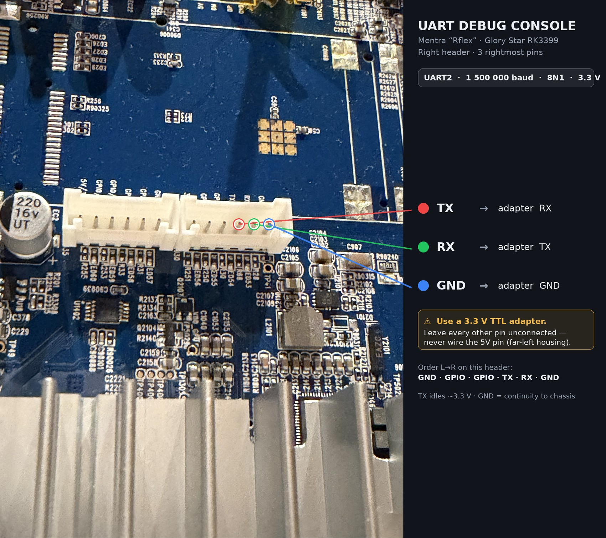

# Unlocking a Glory Star RK3399 Fitness Mirror via UART (Mentra "Rflex" / SATS)

Getting **root and developer mode** on a kiosk-locked Android fitness mirror by talking to its **UART debug console** — no Maskrom, no factory reset, no soldering.

This documents a confirmed, working unlock of a **Mentra by SATS "Rflex"** training mirror (sold in Norway, ~2021, now discontinued and unsupported). The mainboard is a **Rockchip RK3399** built by ODM **Glory Star**. The same board and the same lock almost certainly ship in other RK3399 "smart mirror" products from the same ODM (NordicTrack Vault, Echelon Reflect, ProForm Vue, Fiture and similar), so the method should transfer with minor changes.

> **The one thing that actually matters:** this is a `userdebug` engineering build. The UART console hands you a **root shell**. From root, the whole lock comes off in three commands. Everything else below is just getting a wire onto the right three pins.

---

## ⚠️ Disclaimer

- This is for **a device you own**. Unlocking it **voids any warranty** and can brick it.
- You are working on a **live, mains-adjacent board**. Use a **3.3 V** TTL adapter. **Do not connect the 5 V pin** to your adapter — you will damage the RX pin or worse.
- Removing the management lock **wipes the vendor's device management**; the original Mentra/SATS app experience will not come back without a full firmware restore.
- No warranty, express or implied. If it breaks, you own both halves.

---

## Does this apply to my board? (identification)

Match as many of these as you can before trusting the pinout:

| Thing | Value on this board |
|---|---|
| SoC | Rockchip **RK3399** |
| Build fingerprint | `rk3399_Android10-userdebug … eng.glorys.20211101` |
| Build type | **`userdebug`** (this is the key — gives you `su`) |
| Front silkscreen | `861_4F_RK3399_V1.8` |
| PCB part no. | `EPC.L8320100012-R` |
| PMIC | Rockchip **RK808-D** |
| eMMC | FORESEE **FSE1ASLD-64G** (64 GB) |
| Wi-Fi/BT | Ampak **AP6398SR3** |
| Ethernet | Realtek **RTL8211F** + HanRun **HY602401** magnetics |
| USB hub | **FE1.1s** |
| PCB fab (UL file) | `E308301` (Shenzhen Fusheng Electronics) |
| Maskrom button | **K3**, labeled `MASKROM`, on the back |
| ODM reference model | Glory Star **"Epsilon" EMT431** (FCC ID `2AACS-EMT431`) |

Check your build type from the UART console with `getprop ro.build.type`. **If it is not `userdebug` or `eng`, stop** — `su` will not work and this exact method does not apply.

---

## What does NOT work (save yourself two evenings)

Both of these are the "obvious" Rockchip/Android paths. On this locked build they are dead ends:

1. **Maskrom + `rkdeveloptool` / RKDevTool read** — Maskrom mode (hold **K3** on power-up, USB-C = OTG, VID:PID `2207:330c`) is reachable, but **reads are blocked** (returns `0xCC` past ~32 MB). You can *write* but you have no valid source image to write, so you can neither back up nor rebuild a partition safely. Useless for removing the lock.
2. **Factory reset** — the lock is a **Device Owner** policy, and the firmware **re-provisions it from `/system` on first boot after a wipe**. A reset drops you straight back into the Mentra onboarding. It does *not* clear the lock.

The reason factory reset fails is also the reason the UART route is *permanent* once it works — see the `setup-complete` note in Step 6.

---

## What you need

**Hardware**
- A **3.3 V USB-to-TTL serial adapter** that can do **1,500,000 baud** (CP2102, CP2104, FT232, or similar). ~€10.
- Three jumper wires / a matching pigtail connector (the console header pitch is JST-style; measure yours — **XH 2.5 mm** and **PH 2.0 mm** 4-pin pigtails cover both common cases).
- A multimeter (to confirm which pin is which).
- 12 V bench supply or the mirror's original PSU to power the board.

**Software**
- A serial terminal:
  - **macOS:** `screen` (built in)
  - **Linux:** `screen` or `minicom`
  - **Windows:** PuTTY

---

## Step 1 — Find the UART debug header

The debug console on an RK3399 is **UART2** at **1,500,000 8N1, 3.3 V**.

On this board it is **not** a dedicated 3-pin header. It's three pins — **TX, RX, GND** — at the **right end of a larger dual-housing JST connector** sitting just above the heatsink. Read the silkscreen: the right housing runs **`GND · GPIO · GPIO · TX · RX · GND`** left to right, and the three pins you want are the **rightmost three** (`TX`, `RX`, and the final `GND`). See the annotated photo below.



(Decoy candidates if this header is dead: several unpopulated back-side 4-pin headers labeled `5V RX TX GND`, and the left housing of this same connector carries `5V/GPIO` pins — **do not** wire the 5 V pin. If the pins above don't produce output, try the back-side headers in turn.)

## Step 2 — Verify the pins with a multimeter

Don't trust silkscreen blindly. Confirm:

1. **GND** → continuity to the board's metal chassis / shield.
2. **5 V pin** (if present on a 4-pin header) → reads ~5 V against GND when powered. **Leave this one disconnected.**
3. **TX** → idles at **~3.3 V** when the board is on. (RX idles lower/floating.)

## Step 3 — Wire the adapter

Serial is crossover — TX goes to RX:

| Adapter | Board header |
|---|---|
| GND | GND |
| **RX** | **TX** |
| **TX** | **RX** |
| *(5 V)* | **leave unconnected** |

Double-check the adapter is strapped to **3.3 V**, not 5 V.

## Step 4 — Open the console

Plug the adapter into your computer and find its device node.

**macOS**
```bash
ls /dev/cu.usbserial-*
screen /dev/cu.usbserial-XXXX 1500000
```

**Linux**
```bash
ls /dev/ttyUSB*
screen /dev/ttyUSB0 1500000
```

**Windows:** PuTTY → Connection type **Serial**, Speed **1500000**, then Open.

Settings: **1500000 8N1, no flow control.**

Now power on the board (apply 12 V). You should see the full boot log scroll past — DDR init, `Starting kernel`, `init:` lines, then Android coming up. **If nothing scrolls, move the adapter to the next candidate header and retry.** Once boot settles, press **Enter**. You should land at a shell prompt:

```
console:/ $
```

## Step 5 — Get root

The prompt starts as the unprivileged `shell` user. Because this is a `userdebug` build, `su` is available:

```bash
id
# uid=2000(shell) gid=2000(shell) ...

su
# prompt changes to:  console:/ #
id
# uid=0(root) gid=0(root) ...
```

On this build the AOSP-style `su <uid> <cmd>` form also works for one-shot commands, e.g. `su 0 id`. **Root achieved — this is the master key.** Everything below runs as root.

## Step 6 — Identify the lock

Find out exactly what is holding the device in kiosk mode:

```bash
getprop ro.build.type          # -> userdebug
getprop ro.debuggable           # -> 1
settings get global adb_enabled # -> 1 (already on here)

cat /data/system/device_policies.xml
cat /data/system/device_owner_2.xml
cat /data/system/device_owner.xml
```

On this device the **Device Owner** is:

```
com.mentra.launcher / com.mentra.internal.services.device.admin.MentraDeviceAdminReceiver
```

That Device Owner (an MDM-style policy) is what produces *"Action not allowed — contact your IT admin"* when you tap **Build number**, and what enforces the kiosk lock-task and the USB/unknown-sources restrictions (`DISALLOW_DEBUGGING_FEATURES`, `no_install_unknown_sources`).

**Critical detail — why this removal is permanent.** Check:

```bash
# device is already past initial setup:
# settings in device_owner_2.xml / dumpsys show setup-complete="true"
```

Android **will not re-provision a Device Owner once setup is complete**. That's exactly why factory reset *failed* (a wipe resets `setup-complete`, letting the firmware re-provision from `/system`). Removing the Device Owner now, on an already-set-up device, makes it **stay gone**.

## Step 7 — Why the "clean" API removal is blocked

The textbook command is refused, because a Device Owner is protected from ordinary removal:

```bash
dpm remove-active-admin com.mentra.launcher/com.mentra.internal.services.device.admin.MentraDeviceAdminReceiver
# -> fails: Device Owner cannot be removed this way
```

So we remove the policy at the **file** level instead.

## Step 8 — Back up the policy files first (reversible)

```bash
mkdir -p /data/local/tmp/dobackup
cp -f /data/system/device_owner_2.xml \
      /data/system/device_owner.xml \
      /data/system/device_policies.xml \
      /data/local/tmp/dobackup/ 2>/dev/null
ls -la /data/local/tmp/dobackup/
```

Keep a copy off-device too if you can (`cat` them over serial and save the output). Restoring these files and rebooting puts the lock back exactly as it was.

## Step 9 — Remove the Device Owner and reboot

```bash
rm -f /data/system/device_owner_2.xml /data/system/device_policies.xml
sync
reboot
```

The board reboots. `device_policies.xml` gets recreated on boot, but **empty** — with no admin, because the Device Owner registration (`device_owner_2.xml`) is gone and can't be re-provisioned (Step 6).

## Step 10 — Verify the lock is gone

After it boots back up, reconnect the shell (`su` again) and confirm:

```bash
dumpsys device_policy | grep -iE "Device Owner|Profile Owner|admin=|package="
# -> no Device Owner reported
```

No Device Owner = kiosk gone, developer options unlocked, restrictions lifted, `adb` usable.

## Step 11 — Switch the home launcher to Launcher3

Mentra is still registered as the home app, so you'd still boot into its (now defanged) screen. The stock Android launcher (`com.android.launcher3`) is present as a fallback. Switch to it and disable Mentra:

```bash
cmd package set-home-activity com.android.launcher3/com.android.launcher3.uioverrides.QuickstepLauncher
pm disable-user --user 0 com.mentra.launcher
```

Verify:

```bash
cmd package resolve-activity -a android.intent.action.MAIN -c android.intent.category.HOME | grep -i packageName
# -> com.android.launcher3
```

Binder errors scrolling in the log right after this are just the Mentra process shutting down — harmless.

**Done.** The mirror is now a normal, unlocked Android device with a standard home screen, developer options open, and `adb` working.

---

## Getting back in / installing your own app

- **Serial always works:** the UART console gives you root (`su`) any time, independent of firmware state. This is your permanent recovery path.
- **adb over USB:** `persist.sys.usb.config` is already `adb` on this board. Connect the board's **USB-C** port to your computer with a proper **USB-A → USB-C data cable** and `adb` should enumerate. Then `adb install your-app.apk`.
- **Install directly from the shell:** `pm install /path/to/your-app.apk` (e.g. from a USB stick mounted under `/mnt` or `/storage`), or `pm install` over the serial root shell.
- **Full flash fallback:** from the root shell, `reboot loader` drops you into the board's *own* U-Boot loader (full read/write) — far more reliable than guessing recovery-key timing or fighting Maskrom.

> Note for mirror projects: **MagicMirror²** is a Node/Electron app, **not** an Android APK. Realistic options once unlocked are a kiosk browser (e.g. Fully Kiosk Browser) pointed at a MagicMirror² server you host elsewhere, set as the home app — or repurpose the panel and drive it from your own SBC.

---

## Reversing the unlock

```bash
su
cp -f /data/local/tmp/dobackup/device_owner_2.xml \
      /data/local/tmp/dobackup/device_policies.xml \
      /data/system/
pm enable com.mentra.launcher
sync
reboot
```

(Restores the Device Owner and the original launcher. `setup-complete` is still true, so the restored policy takes effect from the files directly.)

---

## Generalizing to other RK3399 kiosk devices

The method is not Mentra-specific. For any RK3399 Android kiosk on a `userdebug`/`eng` build:

1. Find **UART2** (1,500,000 8N1, 3.3 V), get the console, `su` to root.
2. `dumpsys device_policy` to find the Device Owner package/receiver.
3. Back up, then delete `device_owner_2.xml` + `device_policies.xml` under `/data/system/`, reboot.
4. `cmd package set-home-activity` to a stock launcher; `pm disable-user` the vendor launcher.

The package names change; the mechanism doesn't.

---

## Credits / notes

- Board ODM identified as **Glory Star Technics (Shenzhen)**; their own comparable model is the **"Epsilon" EMT431** (FCC ID `2AACS-EMT431`). PCB fabricated by **Shenzhen Fusheng Electronics** (UL `E308301`).
- Facts verified on-device (build string, Device Owner package, pin voltages) are stated as such; ODM attribution is inferred from silkscreen, FCC filings and UL records.
- Contributions welcome — especially confirmed pinouts/package names for sibling devices (NordicTrack Vault, Echelon Reflect, ProForm Vue, Fiture). Open a PR with your board's identification table.
